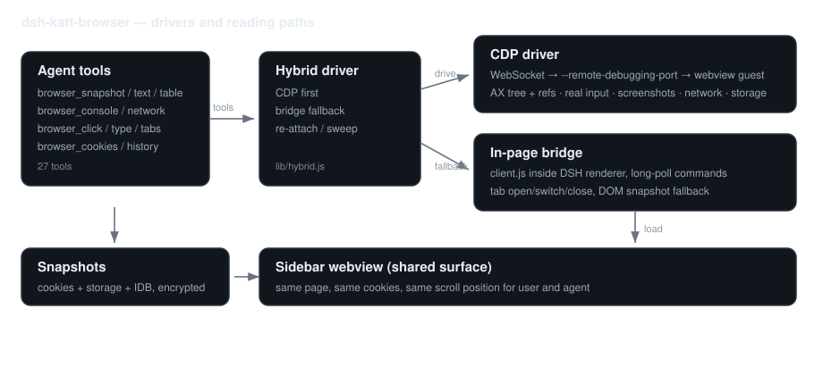
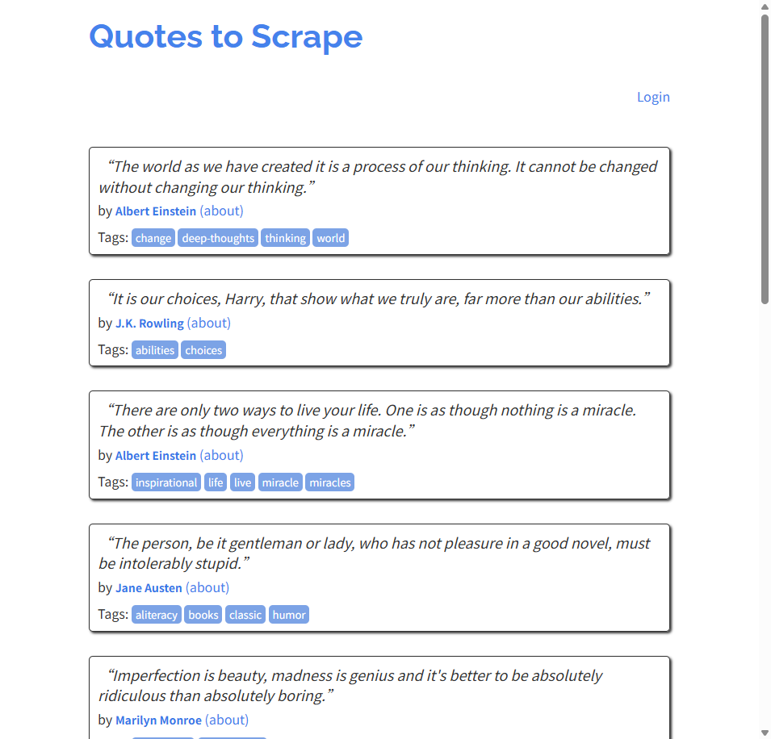
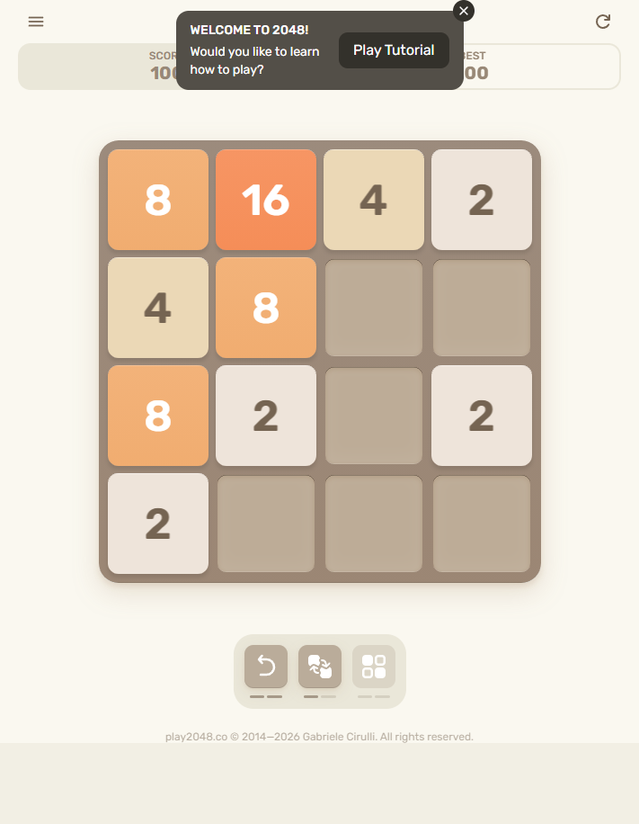

# dsh-katt-browser

English | [中文](README.zh.md)

A DeepSeek Harness (DSH) plugin that turns the desktop app's built-in sidebar browser into an agent-controllable browser.

**Structure first, screenshots last.** Page state is read from the accessibility tree, DOM, worker messages and the network layer; screenshots exist only as a fallback.

## Requirements

- DSH desktop app (Electron, Windows/macOS/Linux) with the sidebar browser.
- The app must be launched with a DevTools port, e.g. `--remote-debugging-port=9222`. The plugin can also fall back to a DOM bridge when CDP is unavailable, but CDP is the primary and recommended path.

## Architecture



Tools talk to a hybrid driver: it attaches to the sidebar webview guest over the DevTools
protocol (WebSocket to `--remote-debugging-port`) and falls back to an in-page bridge when CDP
is unavailable. Account snapshots live beside the driver and are encrypted at rest.

## Install


Or from a local checkout:

dsh plugin --profile desktop add file:/path/to/dsh-katt-browser

Restart DSH after installing. The sidebar browser tab is the shared surface: you and the agent operate the same page, the same cookies and the same scroll position.

## Configuration

```yaml
- id: katt-browser
  config:
    driver: webview        # webview (default) | headless (legacy)
    cdpPort: 9222          # DevTools port used by the desktop app
    idbLimit: 50           # rows per page when snapshotting IndexedDB (500 per DB max)
    downloadDir: ''        # default folder for browser_download
    allowedHosts: []       # non-empty = allow these domains (and subdomains) only
    revealPanel: false     # true = tool calls may open the sidebar (off by default)
    cdpIdleDetachMs: 45000 # detach CDP after this many idle ms (0 = stay attached)
    instrument: true       # false = skip page instrumentation on heavy sites

## What it gives the agent

**Reading (no screenshots)**

- `browser_snapshot` — accessibility tree with `eN` refs; `detail=compact` for interactive elements only
- `browser_text` — readable page text (title, body, links)
- `browser_table` — tables as headers + rows
- `browser_evaluate` — run JS in the page
- `browser_console` — console logs, uncaught exceptions
- `browser_network` — request history (method/URL/status/MIME/duration), filterable
- `browser_instrument` — worker messages, fetch/XHR/WebSocket traffic, storage writes (canvas games expose state here)

**Interaction**

- `browser_open` / `back` / `forward` / `reload` with `waitFor` / `waitMs` for SPA hydration
- `browser_click` (ref or coordinates), `browser_type`, `browser_press_key`, `browser_scroll`, `browser_hover`, `browser_upload`
- `browser_zoom` — `in` / `out` / `reset` / `set` with a 0.25–5 factor (page zoom, layout reflows)
- `browser_tabs` — list / switch / new / close

**Accounts and state**

- `browser_cookies` — `list / save / load / clear / clear-site / clear-cache / profiles`
- Snapshots cover cookies + localStorage/sessionStorage + IndexedDB + Cache Storage, and are encrypted at rest (AES-256-GCM, key under `~/.dsh/katt-browser/profile.key`)
- Default is shared login state inside one workspace partition; switch accounts by loading another snapshot
- `browser_serve` — local HTTP server for local pages (`file://` is blocked by the sidebar webview)
- `browser_download` — native downloads are disabled by the shell, so files are fetched in-page and written to disk
- `browser_history`, `browser_probe`, `browser_page_diag` — diagnostics

## Screenshots

| The page the user sees | What the agent reads instead |
|---|---|
|  | `browser_snapshot` returns roles, names and `eN` refs; `browser_text` returns readable text |

A canvas game whose state never touches the DOM: `browser_instrument` reads the worker messages
(score, board, move count) instead of taking a screenshot.



- `browser_zoom` uses the webview's page zoom (the same control as Ctrl+=, layout reflows) and falls back to CDP page scale / CSS zoom when the panel helper is unavailable.
### Performance

- **Idle detach**: 45 s without a browser call detaches CDP (`cdpIdleDetachMs`), reconnecting on
  the next one. Chromium stops throttling a page that has a debugger attached, so a long-lived
  attachment kept the browser panel rendering at the display refresh rate.
- **Focus emulation is temporary**: enabled for ~4 s around click/type only, instead of always on.
- **Heartbeat**: 8 s instead of 2.5 s, and skipped entirely when the data is unchanged or the
  window is hidden.
- **Instrumentation**: previews only JSON bodies up to 256 KiB; `instrument: false` turns the
  page hooks off on heavy sites.

### Panel visibility (multi-workspace)

Tool calls never open or switch the sidebar on their own: the right column belongs to whichever
session you are looking at, and a call from another workspace must not pull it in front of you.
Reading (snapshot, text, console, network, cookies) and navigation work with the panel collapsed;
real mouse/keyboard input needs it open and returns a `panelHidden` hint instead of failing silently.
Set `revealPanel: true` in the config if you *want* tools to reveal the panel.

## Known limits

- `file://` cannot be opened; use `browser_serve`.
- Native downloads are blocked by the shell; use `browser_download`.
- Service Worker registration itself is not restorable from a snapshot (Cache Storage content is).
- Sites that require a human (login walls, CAPTCHA, rate limits) surface a `barriers` hint; the user completes that step in the sidebar.

## License

MIT

## Usage walkthrough

```text
# 1. read the page as structure, interact by ref
browser_open   url=https://quotes.toscrape.com/
browser_snapshot detail=compact
  [e1] link "Quotes to Scrape"   [e2] link "Login"   [e3] link "(about)" ...

# 2. click a ref (real mouse event), then re-read
browser_click  ref=43            -> https://quotes.toscrape.com/page/2/
browser_text   maxChars=400      -> title, body, links

# 3. debug a page that fails to render
browser_console  level=error     -> uncaught exceptions, console.error
browser_network  filter=api      -> GET /api/... 200 application/json 120ms

# 4. keep and switch accounts
browser_cookies save name=work   -> 17 cookies, 10 local keys, 1 IndexedDB, encrypted
browser_cookies load name=work   -> storageRestored: true

## Discover / plugin market

DSH has no central marketplace; a market is a JSON index you add under
**Plugins → Discover → Index sources**. This repo publishes one (format 1):

- `https://cdn.jsdelivr.net/gh/Kattentions/dsh-katt-browser@main/index.json` (CDN, no redirects)
- `https://raw.githubusercontent.com/Kattentions/dsh-katt-browser/main/index.json` (fallback)

See [MARKET.md](MARKET.md). Direct install works without any index:

```sh
dsh plugin --profile desktop add github:Kattentions/dsh-katt-browser
```
