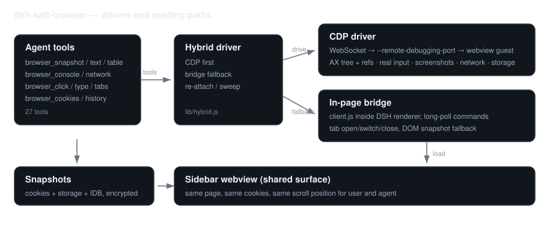
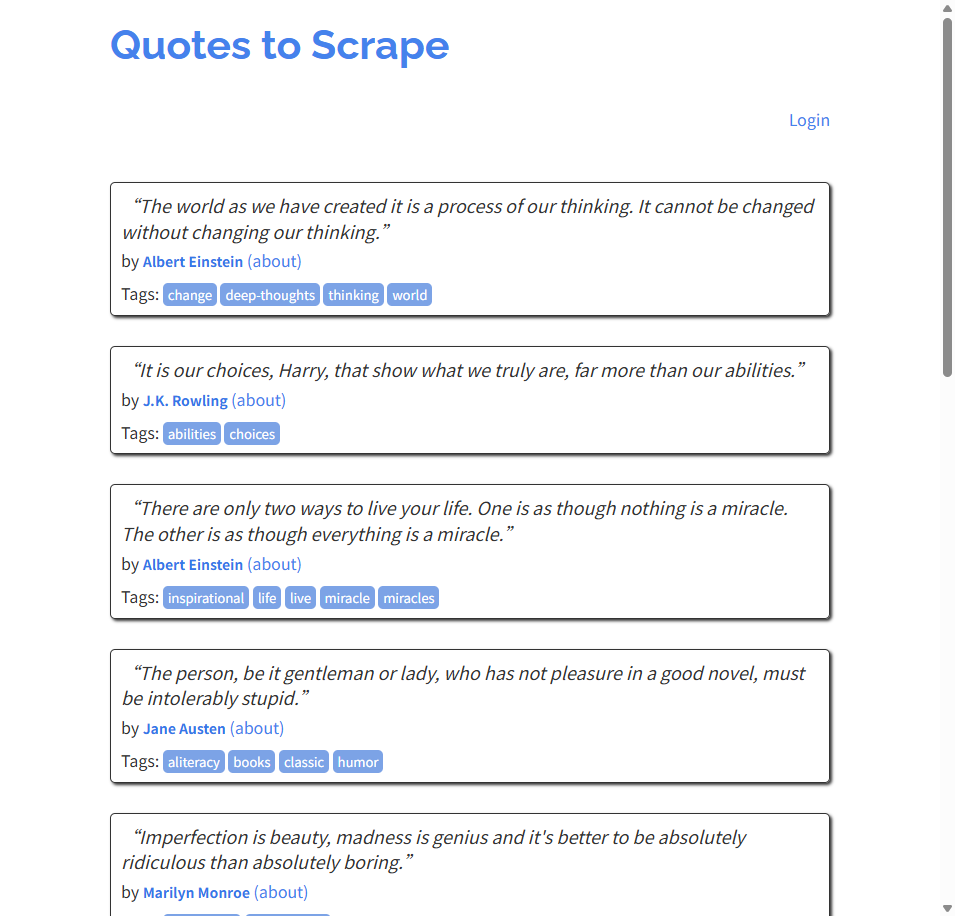
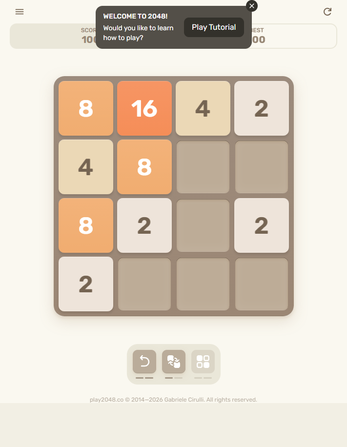

# dsh-katt-browser

[English](README.md) | 中文

DeepSeek Harness（DSH）桌面版插件：把应用内置的侧栏浏览器变成 agent 可以操控的浏览器。

**结构优先，截图最后。** 页面信息来自无障碍树、DOM、worker 消息和网络层；截图只在兜底或需要看视觉效果时使用。

## 环境要求

- DSH 桌面版（Electron，Windows / macOS / Linux），带侧栏浏览器。
- 启动应用时需要带 DevTools 端口，例如 `--remote-debugging-port=9222`。CDP 不可用时插件会退回 DOM 桥，但 CDP 是主通道，推荐开启。

## 架构



工具层统一进混合驱动：优先通过 DevTools 协议（WebSocket 连 `--remote-debugging-port`）附到侧栏 webview 的 guest 上，CDP 不可用时退回页面内桥。账号快照在驱动旁边，落盘加密。

## 最省事的安装

装完就能用：不用加启动参数，不用改配置。

1. DSH 里打开 **插件 → 发现 → 索引源**，加上这个地址：

   ```
   https://cdn.jsdelivr.net/gh/Kattentions/dsh-katt-browser@main/index.json
   ```

   这个源里有两个插件（侧栏浏览器 + 手机桥），点「安装」就行。
2. 装完重启 DSH。
3. 直接让 agent 打开网页即可；右侧栏没开、甚至没打开过浏览器标签页，第一次操作会自动展开。

命令行等价（不需要 git）：

```sh
dsh plugin --profile desktop add https://cdn.jsdelivr.net/gh/Kattentions/dsh-katt-browser@main/dist/dsh-katt-browser-latest.tgz
```

## 安装

下面几种任选，前两种不需要 git。

**1. npm（发布后）**

```sh
dsh plugin --profile desktop add dsh-katt-browser
```

**2. Release 压缩包 —— 不需要 git**

```sh
# 直接从 GitHub Releases 装
dsh plugin --profile desktop add https://github.com/Kattentions/dsh-katt-browser/releases/download/v0.9.9/dsh-katt-browser-0.9.9.tgz

# jsDelivr 镜像（国内通常更快）
dsh plugin --profile desktop add https://cdn.jsdelivr.net/gh/Kattentions/dsh-katt-browser@main/dist/dsh-katt-browser-0.9.9.tgz
```

**3. 下载到本地再装**

解包（`tar -xzf dsh-katt-browser-0.9.9.tgz`）后：

```sh
dsh plugin --profile desktop add file:C:\path\to\package
```

**4. 插件市场（Discover）**

在 **插件 → 发现 → 索引源** 里加上：

```
https://cdn.jsdelivr.net/gh/Kattentions/dsh-katt-browser@main/index.json
```

**5. GitHub 仓库（需要 git）**

```sh
dsh plugin --profile desktop add github:Kattentions/dsh-katt-browser
```


### 打开本地 html（所有入口默认都是这个浏览器）

- 会话里的文件链接、`@` 引用、右侧栏「文件」列表、交付物卡片、技能引用：只要目标是 `.html` / `.htm`，都会在本插件浏览器里打开（自动 `http://127.0.0.1:<port>/...`），不再落到内置的沙箱预览；agent 随后可以 snapshot / click / evaluate
- 实现方式是包装侧栏标签服务的 `openResource`，把 `dsh-resource://file/...` 地址解析成绝对路径后转给本插件；其他文件类型（md/pdf/图片…）保持原预览
- 也可以直接让 agent 用 `browser_open_file`（给路径即可，自动起服务 + 打开），比 `browser_serve` + `browser_open` 少两步
## 配置

```yaml
- id: katt-browser
  config:
    driver: webview        # webview（默认）| headless（旧驱动）
    cdpPort: 9222          # 桌面应用使用的 DevTools 端口
    idbLimit: 50           # IndexedDB 快照每页拉取条数（单库上限 500）
    downloadDir: ''        # browser_download 默认保存目录
    allowedHosts: []       # 非空时只允许访问这些域名及其子域
    revealPanel: false     # true = 工具操作时允许展开侧栏（默认关闭）
    cdpIdleDetachMs: 45000 # 空闲多少毫秒断开 CDP（默认 45000；0 = 不断开）
    instrument: true       # false = 重页面跳过插桩
    homeUrl: https://www.bing.com  # 首次打开、没有历史页时的默认首页
    dataDir: ""            # headless 与页面记忆的根目录，默认 ~/.dsh/katt-browser
    restoreLastPage: true  # 每个会话记住最后打开的页面，新标签/Ctrl+T/重启后恢复
    profileRetentionDays: 14  # headless 每会话 profile 保留天数，启动时清理更旧的
    maxHeadlessBrowsers: 3    # headless 同时保留的实例上限，超出按最久未用淘汰

## 给 agent 的能力

**读取（不靠截图）**

- `browser_snapshot` — 无障碍树 + `eN` 引用；`detail=compact` 只给交互元素
- `browser_text` — 可读正文（标题、正文、链接）
- `browser_table` — 表格转表头 + 行数据
- `browser_evaluate` — 在页面里执行 JS
- `browser_console` — console 日志、未捕获异常
- `browser_network` — 请求历史（方法/URL/状态/MIME/耗时），可按 URL 过滤
- `browser_instrument` — worker 消息、fetch/XHR/WebSocket 流量、存储写入（canvas 游戏的状态通常在这里）

**交互**

- `browser_open` / `back` / `forward` / `reload`，支持 `waitFor` / `waitMs` 等 SPA 水合
- `browser_click`（ref 或坐标）、`browser_type`、`browser_press_key`、`browser_scroll`、`browser_hover`、`browser_upload`
- `browser_zoom` — 页面缩放：`in` / `out` / `reset` / `set`，0.25~5 倍
- `browser_tabs` — 列表（含跨会话归属与排队）/ 切换 / 新建 / 关闭 / 取消排队

**账号与状态**

- `browser_cookies` — `list / save / load / clear / clear-site / clear-cache / profiles`
- 快照覆盖 Cookie + localStorage/sessionStorage + IndexedDB + Cache Storage，落盘加密（AES-256-GCM，密钥在 `~/.dsh/katt-browser/profile.key`）
- 默认是同一 workspace 分区内共享登录态；切换账号就是 `load` 另一份快照
- `browser_serve` — 本地 HTTP 静态服务（侧栏 webview 打不开 `file://`）
- `browser_download` — 壳禁用了原生下载，这里用页面内 fetch 取字节再落盘
- `browser_history`、`browser_probe`、`browser_page_diag` — 诊断工具

## 效果图

| 用户看到的页面 | agent 实际读到的东西 |
|---|---|
|  | `browser_snapshot` 返回角色、名字和 `eN` 引用；`browser_text` 返回可读正文 |

canvas 游戏的状态不进 DOM：`browser_instrument` 直接读 worker 消息（分数、棋盘、步数），不用截图。



## 使用示范

```text
# 1. 按结构读页面，按 ref 操作
browser_open   url=https://quotes.toscrape.com/
browser_snapshot detail=compact
  [e1] link "Quotes to Scrape"   [e2] link "Login"   [e3] link "(about)" ...

# 2. 点一个 ref（真实鼠标事件），再重新读
browser_click  ref=43            -> https://quotes.toscrape.com/page/2/
browser_text   maxChars=400      -> 标题、正文、链接

# 3. 页面白屏/报错时排查
browser_console  level=error     -> 未捕获异常、console.error
browser_network  filter=api      -> GET /api/... 200 application/json 120ms

# 4. 保存和切换账号
browser_cookies save name=work   -> 17 个 Cookie、10 个 localStorage、1 个 IndexedDB，加密落盘
browser_cookies load name=work   -> storageRestored: true
```

### 性能

- **空闲断开 CDP**：45 秒没有浏览器操作就 detach（`cdpIdleDetachMs`），下次操作自动重连。带调试器的页面 Chromium 不做节流，长时间附着会让面板一直按显示器刷新率出帧。
- **焦点模拟只短暂开启**：点击/输入前后约 4 秒，不再常驻。
- **心跳**：2.5 秒 → 8 秒；数据没变化或窗口不可见时完全不发。
- **插桩**：只对 256KB 以内的 JSON 响应取预览；重页面可以 `instrument: false` 关掉页面钩子。

### 多会话与多工作区

右侧栏属于**每个会话自己**：工具只驱动发起工具那个会话的标签页，不会把别的会话正在看的页面导航走。会话之间互不可见、互不覆盖。

- **后台打开会排队**：发起工具时那个会话的右侧栏不可见，页面先排进该会话（2 小时内有效），切回该会话会自动打开；`browser_tabs` 的 `queued` 字段能看到排队明细。
- **设置 → 浏览器**：列出所有会话的标签页（标题、URL、是否当前会话）和排队中的页面，可以直接关闭/取消；headless 模式下还显示实时实例数。
- **每会话页面记忆**：关掉标签、Ctrl+T 新开、或应用重启后，浏览器回到该会话上次的页面，而不是永远回到首页；`restoreLastPage: false` 可关掉。
- **headless 驱动**：每会话一个独立浏览器实例与 profile（`dataDir/sessions/<sessionId>`），Cookie、历史、页面状态互不共享；实例数受 `maxHeadlessBrowsers` 限制。
- **面板可见性**：工具操作不会主动展开或切换右侧栏。面板收起时，读页面（快照/文本/console/网络/Cookie）和导航照常工作；真实鼠标/键盘输入需要面板展开，会返回 `panelHidden` 提示而不是静默失败。想让工具展开面板，把 `revealPanel` 设成 `true`。

## 已知限制

- **headless 驱动**支持核心操作（打开、快照、正文、表格、执行 JS、点击/输入、等待、缩放）和每会话独立实例；console 日志、网络历史、Cookie 快照、页面内下载、文件上传、多标签管理需要 webview 驱动，headless 下会返回明确的「不支持」提示而不是报错。
- `file://` 打不开，用 `browser_serve`。
- 原生下载被壳禁用，用 `browser_download`。
- Service Worker 注册本身无法从快照恢复（Cache Storage 内容可以）。
- 需要人操作的站点（登录墙、验证码、限流）会返回 `barriers` 提示，由用户在侧栏完成那一步。

## 开发自检

工具与驱动之间有静态契约检查：`npm run check` 会扫出所有 `browser.xxx()` 调用，逐个驱动（webview / headless）对比实际实现的方法，缺一个就报错。headless 驱动之前坏了很久就是因为没有这个检查——它只实现了 25 个方法而工具调用 39 个。

## 许可

MIT
